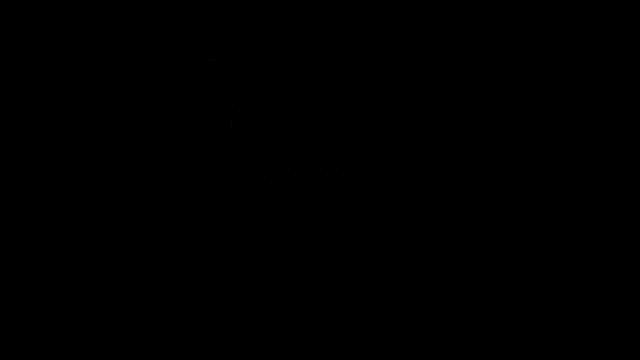

# Punch_Fight_Detection

Sistema de visão computacional que detecta e pontua socos em tempo real usando YOLOv11-pose e análise de ângulos entre articulações.



## Funcionalidades

- Detecção de dois lutadores simultaneamente com IDs persistentes
- Análise de ângulos entre ombro, cotovelo e pulso para detectar socos
- Suavização dos ângulos por média móvel para reduzir oscilações
- Trilha visual de movimento dos pulsos
- Flash de impacto colorido ao detectar um soco
- Placar em tempo real com cores por lutador

## Como funciona a detecção de soco

A detecção usa uma **máquina de estados** baseada no ângulo formado por ombro, cotovelo e pulso:

```
REPOUSO → DOBRADO (ângulo < 70°) → ESTENDIDO (ângulo > 98°) → +1 ponto
```

Um soco só é contabilizado quando o braço passa do estado **dobrado** para **estendido** — não quando já está estendido.

## Estrutura do projeto

```
Punch_Fight_Detection/
├── main.py               
├── requirements.txt
├── README.md
└── functions/
    ├── config.py            # todas as configurações em um lugar só
    ├── detector.py          # detecção de pessoas com YOLOv11-pose
    ├── fighters.py          # estado dos lutadores e lógica de soco
    ├── drawing.py           # funções de desenho no frame
    └── champion.py          # tela de campeão ao fim do vídeo
```

## Como usar

**1. Clone o repositório**
```bash
git clone https://github.com/LucasBarbosa156/Fight_Punch_Detection.git
cd Fight_Punch_Detection
```

**2. Instale as dependências**
```bash
pip install -r requirements.txt
```

**3. Configure o vídeo**

Coloque seu vídeo na pasta `lutas_inputs/` e atualize o caminho em `functions/config.py`:
```python
video_path = "lutas_inputs/seu_video.mp4"
```

**4. Execute**
```bash
python3 main.py
```

Pressione qualquer tecla para encerrar antes do fim do vídeo.

## Configuração

Todos os parâmetros estão centralizados em `functions/config.py`:

| Parâmetro | Descrição | Padrão |
|---|---|---|
| `video_path` | Caminho do vídeo de entrada | `"lutas_inputs/video_da_luta.mp4"` |
| `MODEL_PATH` | Modelo YOLO a usar | `"yolo11m-pose.pt"` |
| `angulo_dobrado` | Ângulo máximo para braço em guarda | `70` |
| `angulo_estendido` | Ângulo mínimo para soco executado | `98` |
| `min_confianca` | Confiança mínima do keypoint | `0.5` |
| `duracao_flash` | Frames que o flash de impacto dura | `4` |

**Dica de calibração:** Os ângulos ideais variam com o ângulo da câmera. Observe os valores exibidos nos cotovelos durante a execução e ajuste os thresholds.

## Recomendações

Para melhor detecção, use vídeos com:
- Câmera **lateral ou frontal** — câmeras em movimento dificultam o tracking
- Boa **iluminação** — ambientes escuros reduzem a confiança dos keypoints
- Os dois lutadores **visíveis simultaneamente** na maior parte do tempo

## Tecnologias

- [YOLOv11 / Ultralytics](https://github.com/ultralytics/ultralytics)
- [OpenCV](https://opencv.org/)
- [NumPy](https://numpy.org/)
